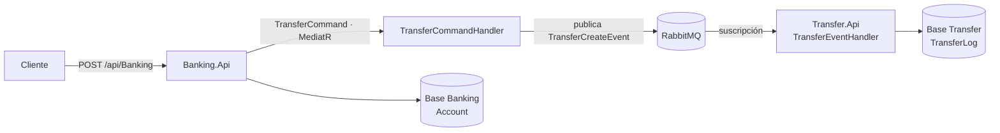

[English](README.md) · **Español**

# 🔀 Microservicios .NET con RabbitMQ


**Dos microservicios en ASP.NET Core que se comunican mediante eventos sobre RabbitMQ, con Clean Architecture y CQRS.**

---

## Sobre el proyecto

Un servicio Banking administra cuentas y pide transferencias; un servicio Transfer las registra. Nunca se llaman directamente: Banking publica un evento en RabbitMQ y Transfer reacciona a él.

Es un proyecto de formación que hice siguiendo el curso de Vaxi Drez [*Clean Architecture en Microservices con ASP.NET 8, RabbitMQ y Docker Containers*](https://www.udemy.com/share/105NX43@IX5aIAOAPNIs9FacO-X_wDRU8F7tUNbp3o4oLNcqATu4L38JESFTaLiJLW6fMqxqbA==/) (Udemy). Lo desplegué en Azure App Service, con PostgreSQL en Supabase y RabbitMQ en CloudAMQP.

## Cómo fluye una transferencia



## Highlights técnicos

- **Comunicación por eventos:** los servicios no comparten base de datos ni se llaman por HTTP; el único contrato entre ellos es el evento.
- **Bus de eventos reutilizable:** `IEventBus` en `Domain.Core` y su implementación con RabbitMQ en `Infra.Bus`, con `Publish<T>` y `Subscribe<T, TH>` genéricos.
- **CQRS con MediatR:** un pedido de transferencia se convierte en un `TransferCommand` cuyo handler publica el evento.
- **Clean Architecture por servicio:** capas Api, Application, Domain y Data, más un proyecto de IoC compartido que registra las dependencias.
- **Deploy en la nube:** Azure App Service, PostgreSQL en Supabase y RabbitMQ administrado en CloudAMQP.

## Arquitectura

| Proyecto | Responsabilidad |
| --- | --- |
| `MicroRabbit.Domain.Core` | Tipos base `Command` y `Event`, contratos `IEventBus` e `IEventHandler` |
| `MicroRabbit.Infra.Bus` | Implementación del bus de eventos con RabbitMQ |
| `MicroRabbit.Infra.IoC` | Registro de dependencias de ambos servicios |
| `MicroRabbit.Banking.*` | Cuentas y pedidos de transferencia: Api, Application, Domain, Data |
| `MicroRabbit.Transfer.*` | Registro de transferencias alimentado por eventos: Api, Application, Domain, Data |

<details>
<summary><b>Estructura del proyecto</b></summary>

```text
MicroServicesRabbitMQ/MicroServicesRabbitMq/
├── MicroServicesRabbitMq.sln
├── MicroRabbit.Domain.Core/
├── MicroRabbit.Infra.Bus/
├── MicroRabbit.Infra.IoC/
├── MicroRabbit.Banking.Api/
├── Microrabbit.Banking.Application/
├── MicroRabbit.Banking.Domain/
├── MicroRabbit.Banking.Data/
├── MicroRabbit.Transfer.Api/
├── MicroRabbit.Transfer.Application/
├── MicroRabbit.Transfer.Domain/
└── MicroRabbit.Transfer.Data/

NetRabbitMq/            Productor y consumidor mínimos de RabbitMQ, usados como práctica previa
```

</details>

## Cómo ejecutar el proyecto

### Requisitos

- .NET 8 SDK
- Docker Desktop, para correr RabbitMQ y PostgreSQL en local

### 1. Levantar RabbitMQ y PostgreSQL

Guardar esto como `docker-compose.yml` y ejecutar `docker compose up -d`:

```yaml
services:
  rabbitmq:
    image: rabbitmq:3-management
    ports:
      - "5672:5672"
      - "15672:15672"
  postgres:
    image: postgres:13
    ports:
      - "5432:5432"
    environment:
      POSTGRES_USER: postgres
      POSTGRES_PASSWORD: password
```

### 2. Configurar cada servicio

En `MicroRabbit.Banking.Api/appsettings.json`:

```json
"ConnectionStrings": {
  "BankingDbConnection": "Host=localhost;Database=bankingdb;Username=postgres;Password=password"
},
"RabbitMqSettings": {
  "HostName": "localhost",
  "UserName": "guest",
  "Password": "guest"
}
```

En `MicroRabbit.Transfer.Api/appsettings.json`, la misma configuración, con la cadena de conexión llamada `TransferDbConnection` y apuntando a `transferdb`.

<!-- TODO: Transfer.Api/appsettings.json hoy nombra la clave BankingDbConnection, pero Program.cs lee TransferDbConnection -->

### 3. Crear las bases y ejecutar

```bash
git clone https://github.com/EmilianoBazanZapata/Microservices-.Net.git
cd Microservices-.Net/MicroServicesRabbitMQ/MicroServicesRabbitMq
```

Las migraciones no están en el repo, así que primero hay que crearlas. Desde la carpeta de cada proyecto Api (el ejemplo es Banking; Transfer es igual con sus propios nombres):

```bash
cd MicroRabbit.Banking.Api
dotnet ef migrations add InitialCreate --project ../MicroRabbit.Banking.Data
dotnet ef database update --project ../MicroRabbit.Banking.Data
dotnet run
```

Swagger queda disponible en `http://localhost:5162/swagger` (Banking) y `http://localhost:5001/swagger` (Transfer).

### Probarlo

Enviar una transferencia con `POST /api/Banking` y después consultar `GET /api/Transfer` para ver el registro que escribió el evento. Usar montos menores a **1.000**: los saldos se guardan como `decimal(5,2)`.

## Créditos

Hecho por Emiliano Bazán-Zapata siguiendo el curso de **Vaxi Drez** en Udemy.

---

**Binary Suns Studio** · [Web](https://binarysunsstudio.com.ar) · [GitHub](https://github.com/EmilianoBazanZapata) · [LinkedIn](https://www.linkedin.com/in/emiliano-bazán-zapata-18705721a)
