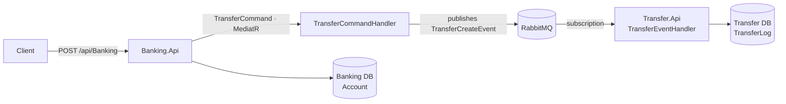

**English** · [Español](README.es.md)

# 🔀 .NET Microservices with RabbitMQ


**Two ASP.NET Core microservices that communicate through events on RabbitMQ, built with Clean Architecture and CQRS.**

---

## About the project

A Banking service manages accounts and requests transfers; a Transfer service records them. They never call each other directly: Banking publishes an event on RabbitMQ and Transfer reacts to it.

It's a training project built while following Vaxi Drez's course [*Clean Architecture en Microservices con ASP.NET 8, RabbitMQ y Docker Containers*](https://www.udemy.com/share/105NX43@IX5aIAOAPNIs9FacO-X_wDRU8F7tUNbp3o4oLNcqATu4L38JESFTaLiJLW6fMqxqbA==/) (Udemy). I deployed it to Azure App Service, with PostgreSQL on Supabase and RabbitMQ on CloudAMQP.

## How a transfer flows



## Technical highlights

- **Event-driven communication:** services share no database and make no HTTP calls to each other; the only contract between them is the event.
- **Reusable event bus:** `IEventBus` in `Domain.Core` and its RabbitMQ implementation in `Infra.Bus`, with generic `Publish<T>` and `Subscribe<T, TH>`.
- **CQRS with MediatR:** a transfer request becomes a `TransferCommand` whose handler publishes the event.
- **Clean Architecture per service:** Api, Application, Domain and Data layers, plus a shared IoC project that wires dependencies.
- **Cloud deployment:** Azure App Service, PostgreSQL on Supabase and managed RabbitMQ on CloudAMQP.

## Architecture

| Project | Responsibility |
| --- | --- |
| `MicroRabbit.Domain.Core` | Base `Command` and `Event` types, `IEventBus` and `IEventHandler` contracts |
| `MicroRabbit.Infra.Bus` | RabbitMQ implementation of the event bus |
| `MicroRabbit.Infra.IoC` | Dependency registration for both services |
| `MicroRabbit.Banking.*` | Accounts and transfer requests: Api, Application, Domain, Data |
| `MicroRabbit.Transfer.*` | Transfer log fed by events: Api, Application, Domain, Data |

<details>
<summary><b>Project structure</b></summary>

```text
MicroServicesRabbitMQ/MicroServicesRabbitMq/
├── MicroServicesRabbitMq.sln
├── MicroRabbit.Domain.Core/
├── MicroRabbit.Infra.Bus/
├── MicroRabbit.Infra.IoC/
├── MicroRabbit.Banking.Api/
├── Microrabbit.Banking.Application/
├── MicroRabbit.Banking.Domain/
├── MicroRabbit.Banking.Data/
├── MicroRabbit.Transfer.Api/
├── MicroRabbit.Transfer.Application/
├── MicroRabbit.Transfer.Domain/
└── MicroRabbit.Transfer.Data/

NetRabbitMq/            Minimal RabbitMQ producer and consumer, used as a warm-up
```

</details>

## Getting started

### Requirements

- .NET 8 SDK
- Docker Desktop, to run RabbitMQ and PostgreSQL locally

### 1. Start RabbitMQ and PostgreSQL

Save this as `docker-compose.yml` and run `docker compose up -d`:

```yaml
services:
  rabbitmq:
    image: rabbitmq:3-management
    ports:
      - "5672:5672"
      - "15672:15672"
  postgres:
    image: postgres:13
    ports:
      - "5432:5432"
    environment:
      POSTGRES_USER: postgres
      POSTGRES_PASSWORD: password
```

### 2. Configure each service

In `MicroRabbit.Banking.Api/appsettings.json`:

```json
"ConnectionStrings": {
  "BankingDbConnection": "Host=localhost;Database=bankingdb;Username=postgres;Password=password"
},
"RabbitMqSettings": {
  "HostName": "localhost",
  "UserName": "guest",
  "Password": "guest"
}
```

In `MicroRabbit.Transfer.Api/appsettings.json`, the same settings, with the connection string named `TransferDbConnection` and pointing to `transferdb`.

<!-- TODO: Transfer.Api/appsettings.json currently names the key BankingDbConnection, but Program.cs reads TransferDbConnection -->

### 3. Create the databases and run

```bash
git clone https://github.com/EmilianoBazanZapata/Microservices-.Net.git
cd Microservices-.Net/MicroServicesRabbitMQ/MicroServicesRabbitMq
```

Migrations are not committed, so create them first. From each Api project folder (shown for Banking; Transfer is the same with its own names):

```bash
cd MicroRabbit.Banking.Api
dotnet ef migrations add InitialCreate --project ../MicroRabbit.Banking.Data
dotnet ef database update --project ../MicroRabbit.Banking.Data
dotnet run
```

Swagger is available at `http://localhost:5162/swagger` (Banking) and `http://localhost:5001/swagger` (Transfer).

### Try it

Send a transfer with `POST /api/Banking`, then check `GET /api/Transfer` to see the log written by the event. Keep amounts under **1,000**: balances are stored as `decimal(5,2)`.

## Credits

Built by Emiliano Bazán-Zapata following the course by **Vaxi Drez** on Udemy.

---

**Binary Suns Studio** · [Website](https://binarysunsstudio.com.ar) · [GitHub](https://github.com/EmilianoBazanZapata) · [LinkedIn](https://www.linkedin.com/in/emiliano-bazán-zapata-18705721a)
